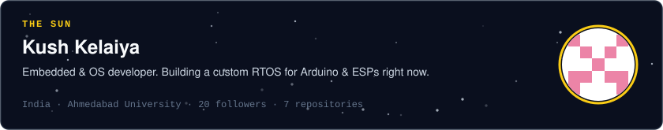
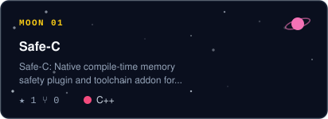
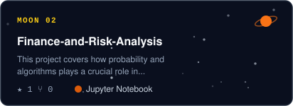
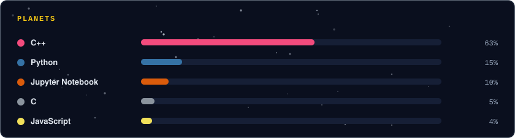
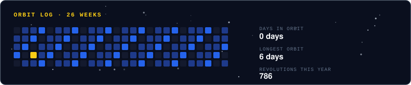

I am the sun; my languages are the planets and my projects their moons.

  

<table>
  <tr>
    <td width="50%">
      
    </td>
    <td width="50%">
      
    </td>
  </tr>
</table>

  

  <a href="https://github.com/Kush-Kelaiya22">GitHub</a> ·
  <a href="https://www.linkedin.com/in/kush-kelaiya-920345322/">LinkedIn</a> ·
  <a href="https://instagram.com/kushkelaiya">Instagram</a> ·
  <a href="mailto:kelaiyakush@gmail.com">Email</a>

---

Solar System · planets are languages, comets are recent pushes · 
